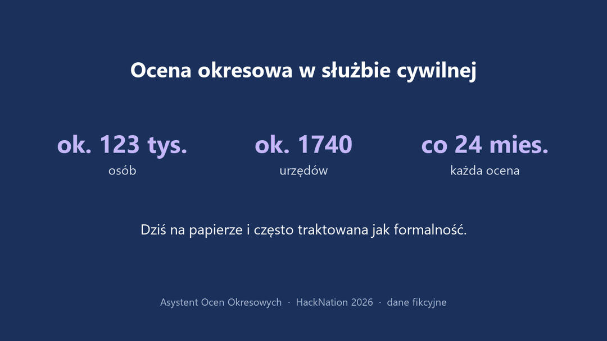

# HackNation 2026 – Cyfrowy Asystent Ocen Okresowych

> Aplikacja konkursowa (zadanie KPRM). Dane domenowe KPRM (kryteria, arkusze, reguły, baza wiedzy) są w
> [`data/kprm/`](data/kprm/README.md). Zadanie i scenariusz demo: [`docs/task.md`](docs/task.md).

Python + FastAPI (API) + Streamlit (interfejs) + SQLite + asystent AI (model lokalny przez Ollamę, z wersją bez AI).



**Najprościej (mały urząd, jeden komputer, bez Dockera i bez IT):** zainstaluj
[Pythona 3.10+](https://www.python.org/downloads/) (Windows: zaznacz „Add python.exe to PATH”), pobierz repozytorium
(`git clone` albo „Code → Download ZIP” i rozpakuj) i uruchom:

- **Windows:** dwuklik w `Uruchom.bat`
- **macOS / Linux:** `sh uruchom.sh`

Za pierwszym razem skrypt tworzy środowisko `.venv`, instaluje biblioteki (kilka minut, potrzebny internet) i plik
ustawień `.env`; potem start trwa kilka sekund. Aplikacja otwiera się w przeglądarce (http://localhost:8000; gdy port
jest zajęty – następny wolny). Zatrzymanie: zamknij okno albo Ctrl+C. Dane zostają w `data/app.db`.
Opcje: `--port 9000`, `--siec` (dostęp z innych komputerów w sieci urzędu), `--bez-przegladarki`.
Asystent AI nie jest potrzebny – bez modelu działają szablony i reguły.

**Dla programistów** (po instalacji z punktu 1, w katalogu głównym repozytorium):
```bash
streamlit run frontend/app.py
```
i otwórz **http://localhost:8501** (API działa w tym samym procesie). Szczegóły w punkcie 2.

```
backend/
  config.py     # wczytuje .env / st.secrets
  llm.py        # ask_llm(), ask_llm_json() – fallback po liście modeli
  parsers.py    # PDF, XML, CSV/XLSX, TXT, OCR -> tekst/dict/DataFrame
  db.py         # baza danych (SQLite, opcjonalnie PostgreSQL)
  main.py       # FastAPI: /api/...
  kprm.py       # jedyny czytelnik danych KPRM z data/kprm
  sheet_pdf.py  # PDF arkusza A/B/C zgodny ze wzorem z rozporządzenia
app/
  domain/       # reguły oceny (§ 11), terminy, cykl oceny, dostęp – czysty Python
  application/  # przypadki użycia procesu oceny, powiadomienia, raporty, asystent AI
  infrastructure/ # adaptery: dane KPRM, baza, e-mail, e-Akt, EZD, import kadr i RCP, modele AI
  api/          # endpointy /api, stan aplikacji (state.py), dane demo (demo_seed.py), schematy kontraktu
frontend/       # interfejs Streamlit: app.py (menu, górny pasek), views/ (strony), api_client.py (tylko /api)
Uruchom.bat / uruchom.sh # start jednym poleceniem (wywołują scripts/uruchom.py)
scripts/
  uruchom.py       # .venv + biblioteki + .env + wolny port + przeglądarka
  check_setup.py   # sprawdza instalację i klucze
  gen_fake_data.py # dane syntetyczne
data/              # dane testowe (bazy .db nie są commitowane)
```

## 1. Instalacja ręczna

Wymagany Python 3.10+ (`python --version`) i git.

**Windows (PowerShell):**
```powershell
git clone https://github.com/WojakR/WOO.git
cd WOO
python -m venv .venv
.venv\Scripts\Activate.ps1      # błąd o skryptach? -> Set-ExecutionPolicy -Scope CurrentUser RemoteSigned
pip install -r requirements.txt
copy .env.example .env
```

**macOS / Linux:**
```bash
git clone https://github.com/WojakR/WOO.git
cd WOO
python3 -m venv .venv
source .venv/bin/activate
pip install -r requirements.txt
cp .env.example .env
```

Aplikacja ocen działa bez żadnych kluczy. Klucze w `.env` są potrzebne tylko w trybie `AI_MODE=api`
(model zewnętrzny, punkt 2). Sprawdzenie instalacji:

```bash
python scripts/check_setup.py
```

Wszystko ma być ✅.

## 2. Uruchamianie

Wszystkie polecenia z katalogu głównego repozytorium, z aktywnym `.venv`.

```bash
streamlit run frontend/app.py            # aplikacja -> http://localhost:8501 (API w tym samym procesie)
uvicorn backend.main:app --reload        # samo API -> http://localhost:8000/docs (z nim: API_URL=http://localhost:8000)
python -m pytest -q                      # testy (bez kluczy i bez modelu AI)
```

Port zajęty? `streamlit run frontend/app.py --server.port 8765` i otwórz http://localhost:8765.
Dostęp z innych komputerów w sieci urzędu: dodaj `--server.address 0.0.0.0` (i otwórz port w zaporze).

### Serwer urzędu w Dockerze

Na serwerze z Dockerem, w katalogu głównym repozytorium:

```bash
docker compose up -d          # buduje obraz i startuje -> http://<serwer>:8000
docker compose logs -f        # dziennik
docker compose down           # zatrzymanie; dane zostają w wolumenie "oceny-dane"
```

- Baza SQLite jest w wolumenie (`/data/app.db`), więc przetrwa restart i aktualizację obrazu
  (`git pull` + `docker compose up -d --build`). `docker compose down -v` usuwa też dane.
- Ustawienia: opcjonalny plik `.env` obok (wzór w `.env.example`). Inny port: `PORT=9000 docker compose up -d`.
- AI domyślnie wyłączone (szablony i reguły). Model lokalny: Ollama na tym samym serwerze i `AI_MODE=local`
  (kontener łączy się z `host.docker.internal:11434`).
- W kontenerze działa ten sam interfejs co lokalnie (Streamlit, z API w tym samym procesie) na porcie 8000.
- Obraz jest sprawdzany w CI (zadanie `docker`: budowa, start, strona aplikacji, odpowiedź API, dane po restarcie).

### Co zobaczysz

Aplikacja startuje z danymi przykładowymi (osoby z `data/kprm/pracownicy.json`, notatki z
`notatki_testowe.json`) i zegarem demo ustawionym na **25.05.2026**. Dane są zapisywane w bazie
(`data/app.db`) i przetrwają restart.

Menu po lewej (oceniający / dział kadr):
- **Mój zespół** (dla kadr: **Oceny w urzędzie**) – lista pracowników, etapy procesu, „Wymaga uwagi”; z listy
  otwierasz arkusz oceny: kryteria ze skalą 1–9, dowody z notatek i sugestie, wynik liczony na żywo (§ 11),
  uzasadnienie i wnioski IPRZ ze szkicem od asystenta, HR partner;
- **Dashboard** (raporty), **Archiwum**, **Terminy**, **Pomoc** (podręcznik), **Ustawienia** albo – dla kadr –
  **Panel administratora** (pracownicy, przepisy, urząd, archiwum kadr, integracje).

Oceniany widzi **Moja ocena**, **Moje wnioski**, **Archiwum**, **Pomoc** i **Ustawienia**.

Panel demo (tylko demo, zamiast logowania):
- **Zalogowany jako** – Henryk Pryncypał (oceniający Grzegorza), Grzegorz Wzór (oceniany), Dział kadr (wszyscy) itd.;
- **+1 dz. / +7 dni / +30 dni / Ustaw datę** – przesuwa zegar serwera (terminy, przypomnienia);
- **↺ Przywróć dane przykładowe**.

Scenariusz demo: jako Henryk otwórz ocenę Grzegorza → przejrzyj sugestie → wstaw szkic uzasadnienia i
wniosków IPRZ → zatwierdź ocenę i przekaż do zapoznania → przełącz się na Grzegorza → potwierdź zapoznanie
się z oceną → pobierz PDF arkusza. Pełny opis pracy dla każdej roli (oceniający, oceniany, kadry, administrator):
[`docs/podrecznik.md`](docs/podrecznik.md) – ten sam tekst jest w aplikacji w zakładce „Pomoc”.

### Asystent AI (opcjonalnie)

Bez modelu wszystko działa – szkice i podpowiedzi powstają z szablonów i reguł (w górnym pasku:
„model lokalny niedostępny – szablony”). Tryb ustawiasz w `.env`:

| `AI_MODE` | Działanie |
|---|---|
| `local` (domyślnie) | model lokalny przez Ollamę; gdy nie działa – szablony |
| `off` | tylko szablony i reguły |
| `api` | model zewnętrzny przez LiteLLM (`LLM_MODELS`, klucz dostawcy w `.env`); dane osobowe pseudonimizowane przed wysłaniem; awaria – szablony |

Model lokalny: zainstaluj [Ollamę](https://ollama.com), potem
`ollama pull SpeakLeash/bielik-11b-v2.3-instruct:Q4_K_M` i uruchom aplikację ponownie.
Szczegóły: [`docs/asystent.md`](docs/asystent.md).

## 3. Wdrożenie w urzędzie

- **Logowanie:** `AUTH_MODE=session` w `.env` (zamiast wyboru osoby w górnym pasku), konta zakłada administrator:
  `python -m app.api.auth add <login> <id_pracownika|kadry> [--admin]`.
- **Tryb produkcyjny:** `APP_MODE=production` – zegar Europe/Warsaw, bez danych przykładowych i bez przewijania czasu.
- **Pracownicy:** Panel administratora → Pracownicy: formularz albo import z systemu kadrowego (CSV/XLSX, z podglądem błędów).
- **Przypomnienia e-mailem:** serwer SMTP w `.env` i zadanie cykliczne `python -m app.application.notify_job`
  (cron / Harmonogram zadań Windows, np. co godzinę w godzinach pracy).
- **Zmiana przepisów:** Panel administratora → Przepisy – nowa wersja z datą wejścia w życie, bez zmian w kodzie.
- **Aktualizacja:** `git pull` (albo nowy ZIP) i ponowne uruchomienie; w Dockerze `docker compose up -d --build`.
  Dane zostają w bazie.

## 4. Import zeskanowanych arkuszy – OCR (opcjonalnie)

Instalujesz Tesseract z polskim językiem (Windows: instalator UB-Mannheim, zaznacz Polish; macOS: `brew install tesseract tesseract-lang`), dla PDF-ów także Poppler, potem:
`pip install pytesseract pdf2image`

## 5. Dla programistów

- Dokumentacja techniczna: [`docs/api.md`](docs/api.md) (kontrakt API), [`docs/model-danych.md`](docs/model-danych.md),
  [`docs/terminy.md`](docs/terminy.md) (liczenie terminów z przykładami KPRM), [`docs/asystent.md`](docs/asystent.md) (AI).
- Wywołania modelu językowego są tylko w `backend/llm.py` (`ask_llm()` / `ask_llm_json()` – zawsze z pseudonimizacją
  danych osobowych). Kolejność modeli w `LLM_MODELS`; gdy pierwszy zawiedzie, wchodzi następny.
- Dane syntetyczne do testów: `python scripts/gen_fake_data.py --n 500`.
- Samo API (bez interfejsu): `uvicorn backend.main:app --reload` -> http://localhost:8000/docs; interfejs korzysta z
  niego, gdy w `.env` jest `API_URL=http://localhost:8000`.
