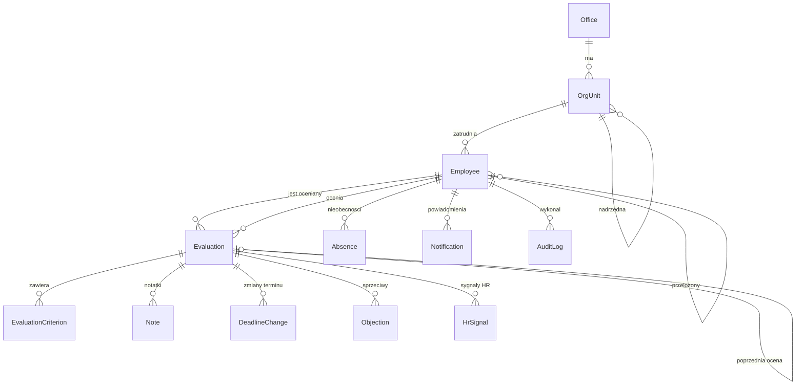

# Model danych – Cyfrowy asystent ocen okresowych

Baza: **SQLite** na hackathon (plik `app.db`). Dostęp tylko przez SQLAlchemy/SQLModel, więc przejście na PostgreSQL to zmiana `DATABASE_URL`.

Legenda: 🟢 = potrzebne do 20:00, 🟡 = druga połowa hackathonu.

---

## Stan wdrożenia (MVP)

Dane są w bazie (`DATABASE_URL`; SQLite w jednym pliku albo PostgreSQL) w uproszczonej postaci: jedna tabela na
agregat – `ocena`, `notatka`, `nieobecnosc`, `zmiana_terminu`, `zastepstwo`, `stan` – z kolumnami do wyszukiwania
(identyfikatory, osoby, status, daty) i całym obiektem domeny jako JSON (`app/infrastructure/sql_store.py`).
Pełny model relacyjny poniżej to kolejny krok; dane przetrwają restart i mogą być przechowywane przez cały czas
zatrudnienia, a potem archiwizowane (bez automatycznego usuwania).

## Diagram ER

---

## Słowniki (enumy)

| Enum | Wartości |
|---|---|
| `TypZatrudnienia` | `URZEDNIK` (mianowany), `PRACOWNIK` (umowa o pracę) |
| `Arkusz` | `A` (kierownik urzędu), `B` (bezpośrednie kierowanie pracownikami), `C` (pozostałe) |
| `Rola` | `PRACOWNIK`, `KADRY`, `DYREKTOR_GENERALNY`, `ADMIN` (rola oceniającego wynika z podległości, nie z pola) |
| `StatusOceny` | `KRYTERIA_DO_WYZNACZENIA` → `KRYTERIA_DO_POTWIERDZENIA` → `OKRES_OCENY` → `ROZMOWA_OCENIAJACA` → `OCENA_DO_ZAPOZNANIA` → `ZAKONCZONA`; dodatkowo `SPRZECIW`, `ANULOWANA` |
| `Punkty` | `1, 3, 5, 7, 9` |
| `Poziom` | `ZNACZNIE_PONIZEJ` (1–2), `PONIZEJ` (>2–4), `NA_POZIOMIE` (>4–6), `POWYZEJ` (>6–8), `ZNACZNIE_POWYZEJ` (>8–9) |
| `Wynik` | `POZYTYWNA` (na poziomie i wyżej **i** żadna ocena cząstkowa nie jest równa 1), `NEGATYWNA` (poniżej i znacznie poniżej **albo** choć jedno kryterium ma 1 pkt), § 11 ust. 1 pkt 3–4 |
| `WniosekOStopien` | `TAK`, `NIE`, `NIE_DOTYCZY` |
| `TypKryterium` | `OBOWIAZKOWE`, `DODATKOWE` |
| `TypNieobecnosci` | `L4`, `URLOP_WYPOCZYNKOWY`, `URLOP_RODZICIELSKI`, `INNA_USPRAWIEDLIWIONA`, `NIEUSPRAWIEDLIWIONA` |
| `PowodZmianyTerminu` | `NIEOBECNOSC_OCENIANEGO_AUTO` (art. 81 ust. 7), `PRZEWIDYWANA_NIEOBECNOSC_OCENIANEGO`, `PRZEWIDYWANA_NIEOBECNOSC_OCENIAJACEGO`, `WNIOSEK_OCENIANEGO`, `INNY` (art. 81 ust. 8), `ZMIANA_STANOWISKA` (art. 81 ust. 6, § 9 ust. 2) |
| `TypNotatki` | `OBSERWACJA`, `BIEZACY_FEEDBACK`, `ROZMOWA_ROZPOCZYNAJACA`, `ROZMOWA_OCENIAJACA` |
| `Wydzwiek` | `POZYTYWNY`, `NEUTRALNY`, `NEGATYWNY` |
| `StatusKlasyfikacji` | `BRAK`, `W_TOKU`, `SUGESTIA` (pewna propozycja AI), `DO_PRZYPISANIA` (niska pewność albo tryb bez AI – wybiera przełożony), `ZATWIERDZONA`, `RECZNA`, `BLAD` (klasyfikacja notatki przez AI) |
| 🟡 `TypSygnaluHr` | `PRZECIAZENIE`, `DLUGA_NIEOBECNOSC`, `ZMIANA_OBOWIAZKOW`, `SPADEK_OCEN`, `DO_DOCENIENIA` |
| 🟡 `StatusSygnaluHr` | `NOWY`, `ZAAKCEPTOWANY`, `ODRZUCONY` |

### `StatusOceny` a statusy z `reguly.json` i domeny

Kanoniczny jest `StatusOceny` (ma etapy oczekiwania, sprzeciw i anulowanie; tak też proponuje `docs/api.md`, punkt 1
„Do uzgodnienia”). Domena (`app/domain/cycle.py`, `Status`) i `reguly.json["statusy_procesu"]` używają jeszcze
nazw zdarzeń. Do czasu ujednolicenia obowiązuje to mapowanie (w warstwie `app/api`):

| `StatusOceny` | `statusy_procesu` / `Status` w domenie | Uwagi |
|---|---|---|
| `KRYTERIA_DO_WYZNACZENIA` | `cykl_rozpoczety` (`CYCLE_STARTED`) | |
| `KRYTERIA_DO_POTWIERDZENIA` | `kryteria_wyznaczone` (`CRITERIA_SET`) | |
| `OKRES_OCENY` | `kryteria_potwierdzone_przez_ocenianego` (`CRITERIA_CONFIRMED`) | |
| `ROZMOWA_OCENIAJACA` | `rozmowa_oceniajaca_odbyta` (`MEETING_HELD`); po sprzeciwie `ocena_do_ponownego_sporzadzenia` | |
| `OCENA_DO_ZAPOZNANIA` | `ocena_sporzadzona` (`EVALUATION_DONE`) | |
| `ZAKONCZONA` | `ocena_zapoznana` (`ACKNOWLEDGED`), `fikcja_zapoznania`, `ocena_zmieniona` | fikcja = flaga `Evaluation.fikcja_zapoznania`, nie osobny status |
| `SPRZECIW` | `sprzeciw_zlozony` | brak w domenie (🟡) |
| `ANULOWANA` | – | brak w `reguly.json`; do dopisania przy ujednolicaniu |

Przejścia `StatusOceny` (kto może je wykonać):

| Z → Do | Kto | Warunek |
|---|---|---|
| `KRYTERIA_DO_WYZNACZENIA` → `KRYTERIA_DO_POTWIERDZENIA` | oceniający | wybrane 0–3 kryteria dodatkowe bez powtórzeń, ustawiony termin oceny |
| `KRYTERIA_DO_POTWIERDZENIA` → `OKRES_OCENY` | oceniany | potwierdzenie rozmowy i zapoznania z kryteriami |
| `OKRES_OCENY` → `ROZMOWA_OCENIAJACA` | oceniający | wpisana data rozmowy oceniającej |
| `ROZMOWA_OCENIAJACA` → `OCENA_DO_ZAPOZNANIA` | oceniający | wszystkie kryteria mają punkty; IPRZ niepuste; przy `NEGATYWNA` niepuste uzasadnienie; przy wniosku o stopień niepuste umotywowanie |
| `OCENA_DO_ZAPOZNANIA` → `ZAKONCZONA` | oceniany (albo oceniający przy fikcji zapoznania) | ustawione `data_zapoznania` |
| `ZAKONCZONA` → `SPRZECIW` | oceniany | do 7 dni od zapoznania |
| `SPRZECIW` → `ZAKONCZONA` / `ROZMOWA_OCENIAJACA` | dyrektor generalny / kadry | nieuwzględniony albo zmiana oceny / polecenie ponownego sporządzenia |

---

## Encje

### 🟢 Office (urząd)

| Pole | Typ | Uwagi |
|---|---|---|
| id | int PK | |
| nazwa | str | pole „NAZWA URZĘDU” w arkuszu |
| miejscowosc_siedziby | str | domyślna miejscowość w podpisach |

Na hackathon jeden rekord. Pozwala jednak pokazać, że jedna instalacja może obsłużyć kilka urzędów.

### 🟢 OrgUnit (komórka organizacyjna)

| Pole | Typ | Uwagi |
|---|---|---|
| id | int PK | |
| office_id | FK → Office | |
| nazwa | str | np. „Departament Analiz” |
| parent_id | FK → OrgUnit, null | hierarchia (departament → wydział) |

### 🟢 Employee (pracownik)

| Pole | Typ | Uwagi |
|---|---|---|
| id | int PK | |
| imie, nazwisko | str | |
| email | str unique | logowanie i powiadomienia |
| org_unit_id | FK → OrgUnit | |
| stanowisko | str | |
| arkusz | `Arkusz` | wyliczany przy zapisie z flag niżej, z możliwością ręcznej zmiany przez kadry |
| czy_kierownik_urzedu | bool | → arkusz A |
| czy_kieruje_pracownikami | bool | → arkusz B |
| typ_zatrudnienia | `TypZatrudnienia` | decyduje o części III i polach „poprzednia ocena urzędnika” |
| data_zatrudnienia_nieokreslony | date, null | start pierwszego cyklu |
| rok_mianowania | int, null | tylko urzędnik |
| stopien_sluzbowy | int 1–9, null | tylko urzędnik |
| data_przyznania_stopnia | date, null | |
| przelozony_id | FK → Employee, null | **domyślny oceniający** |
| miejscowosc_pracy | str, null | domyślna miejscowość w podpisach |
| rola | `Rola` | |
| aktywny | bool | usunięcie = dezaktywacja + anonimizacja |

### 🟢 CriterionDefinition (słownik kryteriów)

Ładowane przy starcie z `data/kprm/kryteria.json` i `arkusze.json` (przez `backend/kprm.py`). Zmiana przepisów oznacza edycję tych plików, nie kodu.

| Pole | Typ | Uwagi |
|---|---|---|
| kod | str PK | np. `RZETELNOSC`, `KOMUNIKACJA` |
| nazwa | str | |
| opis | text | opis z rozporządzenia, używany też w promptach AI |
| typ | `TypKryterium` | |
| arkusze | str | np. `"C"` albo `"A,B"`: w jakich arkuszach występuje (obowiązkowo) lub może być wybrane (dodatkowo) |
| kolejnosc | int | kolejność wyświetlania |
| aktywne_od, aktywne_do | date, null | 🟡 wersjonowanie po zmianie przepisów |

### 🟢 Evaluation (ocena okresowa, czyli jeden cykl)

| Pole | Typ | Uwagi / pole arkusza |
|---|---|---|
| id | int PK | |
| oceniany_id | FK → Employee | Część I – dane ocenianego (kopiowane do snapshotu przy zatwierdzeniu) |
| oceniajacy_id | FK → Employee | może się zmienić w trakcie cyklu (patrz AuditLog) |
| arkusz | `Arkusz` | ustalany na starcie cyklu |
| status | `StatusOceny` | |
| poprzednia_ocena_id | FK → Evaluation, null | historia, stopień obligatoryjny |
| data_poczatku_cyklu | date | data poprzedniej oceny albo zatrudnienia na czas nieokreślony |
| termin_wyznaczenia_kryteriow | date | +30 dni (+7 po ocenie negatywnej), § 7 rozporządzenia |
| termin_oceny | date | domyślnie +24 mies. (+ nieobecności > 1 mies.); po negatywnej: dzień po 6 mies. od zapoznania, bez przedłużania przez nieobecności; przy zmianie stanowiska > 6 mies. od odniesienia: najpóźniej 30 dni po zmianie; przesuwany przez DeadlineChange. Zasady: `docs/terminy.md` |
| **Część I – kryteria** | | |
| data_wyznaczenia_kryteriow | date, null | |
| potw_oceniajacy_kryteria_at | datetime, null | podpis oceniającego (auto przy potwierdzeniu) |
| potw_oceniajacy_kryteria_miejscowosc | str, null | |
| potw_oceniany_kryteria_at | datetime, null | podpis ocenianego |
| potw_oceniany_kryteria_miejscowosc | str, null | |
| **Część II – ocena** | | |
| data_rozmowy_oceniajacej | date, null | |
| okres_od, okres_do | date, null | domyślnie: data wyznaczenia kryteriów → dzień sporządzenia |
| srednia | decimal(3,2), null | **wyliczana**, nie edytowana ręcznie |
| poziom | `Poziom`, null | wyliczany ze średniej |
| wynik | `Wynik`, null | wyliczany z poziomu |
| uzasadnienie | text, null | obowiązkowe przy `NEGATYWNA` |
| wnioski_iprz | text, null | zawsze obowiązkowe |
| poprz_ocena_reczna_wynik | `Wynik`/`BRAK`, null | tylko gdy brak historii w systemie, tylko urzędnik |
| poprz_ocena_reczna_poziom | `Poziom`, null | jw. |
| poprz_ocena_reczna_data | date, null | jw. |
| wniosek_o_stopien | `WniosekOStopien` | domyślnie `NIE_DOTYCZY` dla pracownika, `NIE` przy negatywnej |
| data_sporzadzenia | datetime, null | auto przy „Zatwierdź ocenę” |
| miejscowosc_oceniajacego | str, null | |
| data_zapoznania | datetime, null | start 7 dni na sprzeciw |
| miejscowosc_ocenianego | str, null | |
| fikcja_zapoznania | bool | ocena doręczona, a oceniany nie mógł lub nie chciał potwierdzić |
| **Część III – wniosek o stopień** (tylko `URZEDNIK` + `TAK`) | | |
| wnioskowany_stopien | int, null | auto: posiadany + 1; blokada przy 9 |
| umotywowanie_wniosku | text, null | obowiązkowe przy `TAK` |
| stopien_obligatoryjny | bool | auto: druga z rzędu ocena `POWYZEJ`/`ZNACZNIE_POWYZEJ` od ostatniego stopnia |
| **Techniczne** | | |
| wersja | int | 1; +1 przy ponownym sporządzeniu po sprzeciwie |
| snapshot_json | json, null | zamrożone dane obu stron w chwili zatwierdzenia (do PDF i historii) |
| created_at, updated_at | datetime | |

### 🟢 EvaluationCriterion (kryterium w konkretnej ocenie)

| Pole | Typ | Uwagi |
|---|---|---|
| id | int PK | |
| evaluation_id | FK → Evaluation | |
| criterion_kod | FK → CriterionDefinition | |
| typ | `TypKryterium` | |
| kolejnosc | int | |
| punkty | `Punkty`, null | ustawiane w etapie `ROZMOWA_OCENIAJACA` |

Ograniczenia:
- `UNIQUE(evaluation_id, criterion_kod)`, czyli bez powtórzeń,
- maks. 3 wiersze `DODATKOWE` na ocenę (walidacja w backendzie),
- wiersze `OBOWIAZKOWE` tworzone automatycznie z `arkusze.json` według arkusza przy założeniu oceny.

### 🟢 Note (obserwacja / notatka z cyklu)

| Pole | Typ | Uwagi |
|---|---|---|
| id | int PK | |
| evaluation_id | FK → Evaluation | |
| autor_id | FK → Employee | |
| data | date | |
| typ | `TypNotatki` | |
| criterion_kod | FK, null | przypisanie do kryterium, potrzebne AI do podsumowania |
| wydzwiek | `Wydzwiek`, null | |
| tresc | text | |
| widoczna_dla_ocenianego | bool | domyślnie `false` |
| status_klasyfikacji | `StatusKlasyfikacji` | domyślnie `BRAK` |
| zrodlo_sugestii | `AI` / `REGULY`, null | skąd są `sugestie_ai`: model albo wersja bez AI (podobieństwo do wskaźników) |
| sugestie_ai | json | lista `{criterion_kod, nazwa, wskaznik, wydzwiek (null w wersji bez AI), pewnosc, fragment}` (jak `SugestiaKlasyfikacji` w `app/api/schemas.py`); AI tylko proponuje, `criterion_kod`/`wydzwiek` ustawia człowiek (akceptacja kopiuje sugestię → `ZATWIERDZONA`) |

To główne źródło danych dla AI (szkic uzasadnienia, spójność punktów, sygnały HR partnera).

### 🟡 HrSignal (sygnał wirtualnego HR partnera)

Podpowiedź dla przełożonego, nigdy diagnoza pracownika. Na demo może być liczony w locie; tabela jest po to, żeby
zapamiętać decyzję przełożonego (`POST /api/hr-signals/{id}/decision`).

| Pole | Typ | Uwagi |
|---|---|---|
| id | int PK | |
| evaluation_id | FK → Evaluation | |
| typ | `TypSygnaluHr` | |
| opis | text | |
| dowody | json | np. id notatek, okresy nieobecności opisane słownie |
| rekomendacje | json | lista tekstów |
| zrodlo_tekstow | str | `AI` albo `REGULY` (sygnał zawsze wykrywają reguły; AI tylko formułuje opis i rekomendacje) |
| status | `StatusSygnaluHr` | domyślnie `NOWY` |
| decyzja_przez_id | FK → Employee, null | |
| decyzja_at | datetime, null | |
| created_at | datetime | |

### 🟡 Absence (nieobecność)

| Pole | Typ | Uwagi |
|---|---|---|
| id | int PK | |
| employee_id | FK → Employee | |
| od, do | date | włącznie |
| typ | `TypNieobecnosci` | |
| usprawiedliwiona | bool | wyliczane z typu |

Moduł terminów skleja kolejne nieobecności, jeśli przerwa między nimi to same dni wolne. Gdy ciąg trwa dłużej niż miesiąc, tworzy `DeadlineChange` z powodem `NIEOBECNOSC_OCENIANEGO_AUTO`.

### 🟡 DeadlineChange (zmiana terminu oceny)

| Pole | Typ | Uwagi |
|---|---|---|
| id | int PK | |
| evaluation_id | FK | |
| powod | `PowodZmianyTerminu` | |
| stary_termin, nowy_termin | date | |
| absence_id | FK, null | przy zmianie automatycznej |
| wnioskujacy_id | FK → Employee, null | przy wniosku ocenianego |
| status | `ZLOZONY` / `ZAAKCEPTOWANY` / `ODRZUCONY` / `AUTO` | |
| uzasadnienie | text, null | |
| decyzja_at | datetime, null | |
| zawiadomienie_wyslane_at | datetime, null | § 8: niezwłoczne pisemne zawiadomienie |
| data_zmiany_stanowiska | date, null | tylko przy `ZMIANA_STANOWISKA`; `nowy_termin` = najpóźniej 30 dni po zmianie, najwcześniej 7 dni przed nią (§ 9 ust. 2) |

Zmiana stanowiska w ciągu 6 mies. od odniesienia **nie** zmienia terminu (§ 9 ust. 1): ocena wraca do `KRYTERIA_DO_WYZNACZENIA` z nowym `termin_wyznaczenia_kryteriow` (30 dni od zmiany) – ślad w `AuditLog` (akcja `ZMIANA_STANOWISKA`), bez wpisu w `DeadlineChange`. Logika: `EvaluationCycle.register_position_change`.

### 🟡 Objection (sprzeciw)

| Pole | Typ | Uwagi |
|---|---|---|
| id | int PK | |
| evaluation_id | FK | |
| data_zlozenia | date | ≤ 7 dni od `data_zapoznania` |
| tresc | text | |
| status | `ZLOZONY` / `NIEUWZGLEDNIONY` / `UWZGLEDNIONY_ZMIANA` / `UWZGLEDNIONY_PONOWNA` | |
| termin_rozpatrzenia | date | +14 dni |
| data_rozpatrzenia | date, null | |
| rozpatrujacy_id | FK → Employee, null | dyrektor generalny |

### 🟡 Notification (powiadomienie / przypomnienie)

| Pole | Typ | Uwagi |
|---|---|---|
| id | int PK | |
| odbiorca_id | FK → Employee | |
| evaluation_id | FK, null | |
| typ | str | np. `PRZYPOMNIENIE_KRYTERIA`, `PRZYPOMNIENIE_TERMIN_OCENY`, `ZMIANA_TERMINU`, `OCENA_DO_ZAPOZNANIA`, `STOPIEN_OBLIGATORYJNY` |
| zaplanowane_na | datetime | |
| wyslane_at | datetime, null | |
| kanal | `EMAIL` / `W_APLIKACJI` | |
| tresc | text | |

### 🟡 AuditLog (dziennik zmian)

| Pole | Typ | Uwagi |
|---|---|---|
| id | int PK | |
| kto_id | FK → Employee | |
| kiedy | datetime | |
| encja, encja_id | str, int | |
| akcja | str | np. `ZMIANA_STATUSU`, `KOREKTA_ADMIN`, `ZMIANA_OCENIAJACEGO` |
| przed_json, po_json | json | |

Pokazuje zgodność z przepisami: „korekta tylko w trybie administratora” zostawia ślad.

### 🟡 AiInteraction (opcjonalnie: rozliczalność AI)

| Pole | Typ | Uwagi |
|---|---|---|
| id | int PK | |
| user_id | FK → Employee | |
| evaluation_id | FK, null | |
| funkcja | str | `PREP_ROZMOWY`, `SZKIC_UZASADNIENIA`, `IPRZ`, `HR_PARTNER` |
| prompt_zanonimizowany | text | to, co faktycznie wyszło do modelu |
| odpowiedz | text | |
| model | str | |
| created_at | datetime | |

---

## Wartości wyliczane (nie trzymać jako edytowalnych)

- `srednia` = średnia arytmetyczna `punkty` ze wszystkich `EvaluationCriterion` oceny,
- `poziom` z progów: 1–2 / >2–4 / >4–6 / >6–8 / >8–9,
- `wynik` = `POZYTYWNA`, gdy `poziom` to `NA_POZIOMIE` lub wyżej **i** żadne kryterium nie ma 1 pkt; w pozostałych przypadkach `NEGATYWNA` (§ 11 ust. 1 pkt 3–4; dane: `reguly.json["ocena_pozytywna_gdy"]`, liczy `app/domain/scoring.py`). Przykład: średnia 6,2 z jednym kryterium na 1 pkt → `NEGATYWNA`,
- `stopien_obligatoryjny` = urzędnik + bieżąca i poprzednia ocena (od ostatniego stopnia) na poziomie `POWYZEJ` lub `ZNACZNIE_POWYZEJ`,
- terminy liczy `app/domain/deadlines.py` + `calendar.py` (24 mies., reguła końca miesiąca, przesunięcie z soboty i święta, nieobecność dłuższa niż miesiąc, ponowna ocena po negatywnej, zmiana stanowiska); zasady i źródła: `docs/terminy.md`,
- `termin_sprzeciwu` = 7 dni od `data_zapoznania` (bez dnia zapoznania, z dnia wolnego na następny roboczy) – wyliczany, nie zapisywany; `Objection.data_zlozenia` musi być ≤ tej daty.

## Seed na demo (🟢)

- 1 urząd, 2 komórki,
- naczelnik (arkusz B) + 4 podwładnych (arkusz C):
  - urzędnik mianowany z wysoką poprzednią oceną (żeby pokazać stopień obligatoryjny),
  - pracownik z kilkunastoma notatkami (do AI),
  - osoba z L4 + urlopem powyżej miesiąca,
  - osoba, która dostanie ocenę negatywną,
- 1 osoba z kadr, 1 dyrektor generalny.
